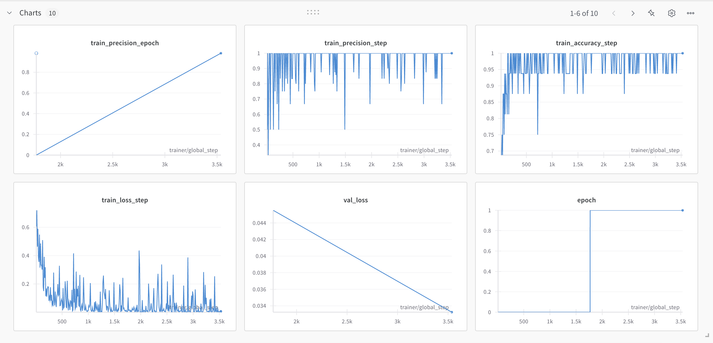
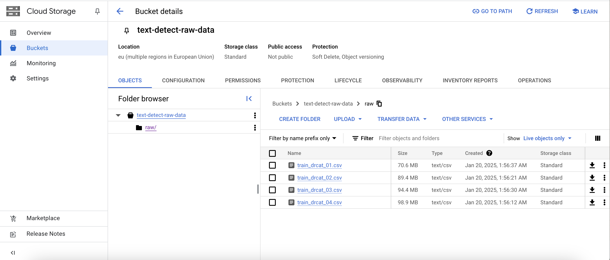
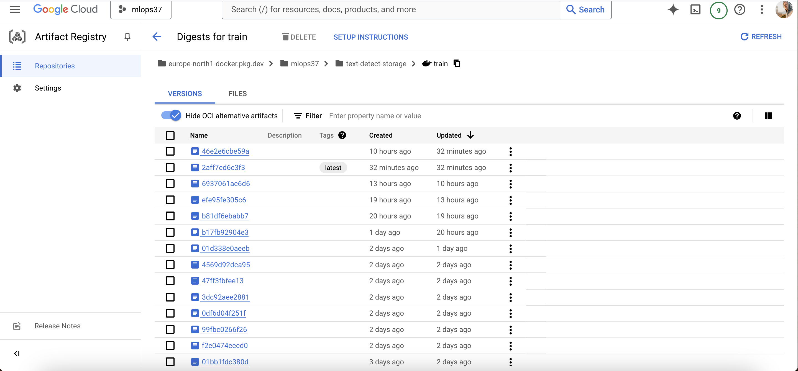
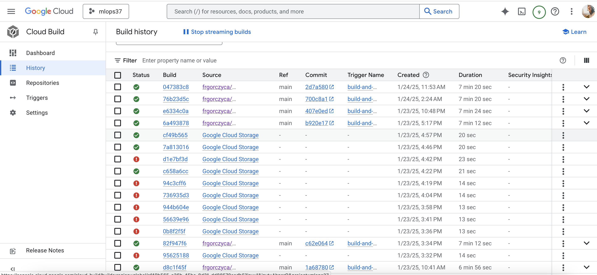

# Exam template for 02476 Machine Learning Operations

This is the report template for the exam. Please only remove the text formatted as with three dashes in front and behind
like:

```--- question 1 fill here ---```

Where you instead should add your answers. Any other changes may have unwanted consequences when your report is
auto-generated at the end of the course. For questions where you are asked to include images, start by adding the image
to the `figures` subfolder (please only use `.png`, `.jpg` or `.jpeg`) and then add the following code in your answer:

```markdown

```

In addition to this markdown file, we also provide the `report.py` script that provides two utility functions:

Running:

```bash
python report.py html
```

Will generate a `.html` page of your report. After the deadline for answering this template, we will auto-scrape
everything in this `reports` folder and then use this utility to generate a `.html` page that will be your serve
as your final hand-in.

Running

```bash
python report.py check
```

Will check your answers in this template against the constraints listed for each question e.g. is your answer too
short, too long, or have you included an image when asked. For both functions to work you mustn't rename anything.
The script has two dependencies that can be installed with

```bash
pip install typer markdown
```

## Overall project checklist

The checklist is *exhaustive* which means that it includes everything that you could do on the project included in the
curriculum in this course. Therefore, we do not expect at all that you have checked all boxes at the end of the project.
The parenthesis at the end indicates what module the bullet point is related to. Please be honest in your answers, we
will check the repositories and the code to verify your answers.

### Week 1

* [X] Create a git repository (M5)
* [X] Make sure that all team members have write access to the GitHub repository (M5)
* [X] Create a dedicated environment for you project to keep track of your packages (M2)
* [X] Create the initial file structure using cookiecutter with an appropriate template (M6)
* [X] Fill out the `data.py` file such that it downloads whatever data you need and preprocesses it (if necessary) (M6)
* [X] Add a model to `model.py` and a training procedure to `train.py` and get that running (M6)
* [X] Remember to fill out the `requirements.txt` and `requirements_dev.txt` file with whatever dependencies that you
    are using (M2+M6)
* [X] Remember to comply with good coding practices (`pep8`) while doing the project (M7)
* [X] Do a bit of code typing and remember to document essential parts of your code (M7)
* [X] Setup version control for your data or part of your data (M8)
* [X] Add command line interfaces and project commands to your code where it makes sense (M9)
* [X] Construct one or multiple docker files for your code (M10)
* [X] Build the docker files locally and make sure they work as intended (M10)
* [X] Write one or multiple configurations files for your experiments (M11)
* [X] Used Hydra to load the configurations and manage your hyperparameters (M11)
* [ ] Use profiling to optimize your code (M12)
* [X] Use logging to log important events in your code (M14)
* [X] Use Weights & Biases to log training progress and other important metrics/artifacts in your code (M14)
* [X] Consider running a hyperparameter optimization sweep (M14)
* [X] Use PyTorch-lightning (if applicable) to reduce the amount of boilerplate in your code (M15)

### Week 2

* [x] Write unit tests related to the data part of your code (M16)
* [x] Write unit tests related to model construction and or model training (M16)
* [X] Calculate the code coverage (M16)
* [X] Get some continuous integration running on the GitHub repository (M17)
* [X] Add caching and multi-os/python/pytorch testing to your continuous integration (M17)
* [X] Add a linting step to your continuous integration (M17)
* [X] Add pre-commit hooks to your version control setup (M18)
* [X] Add a continues workflow that triggers when data changes (M19)
* [X] Add a continues workflow that triggers when changes to the model registry is made (M19)
* [X] Create a data storage in GCP Bucket for your data and link this with your data version control setup (M21)
* [X] Create a trigger workflow for automatically building your docker images (M21)
* [X] Get your model training in GCP using either the Engine or Vertex AI (M21)
* [X] Create a FastAPI application that can do inference using your model (M22)
* [X] Deploy your model in GCP using either Functions or Run as the backend (M23)
* [X] Write API tests for your application and setup continues integration for these (M24)
* [X] Load test your application (M24)
* [X] Create a more specialized ML-deployment API using either ONNX or BentoML, or both (M25)
* [X] Create a frontend for your API (M26)

### Week 3

* [ ] Check how robust your model is towards data drifting (M27)
* [ ] Deploy to the cloud a drift detection API (M27)
* [ ] Instrument your API with a couple of system metrics (M28)
* [ ] Setup cloud monitoring of your instrumented application (M28)
* [ ] Create one or more alert systems in GCP to alert you if your app is not behaving correctly (M28)
* [ ] If applicable, optimize the performance of your data loading using distributed data loading (M29)
* [ ] If applicable, optimize the performance of your training pipeline by using distributed training (M30)
* [ ] Play around with quantization, compilation and pruning for you trained models to increase inference speed (M31)

### Extra

* [ ] Write some documentation for your application (M32)
* [ ] Publish the documentation to GitHub Pages (M32)
* [ ] Revisit your initial project description. Did the project turn out as you wanted?
* [ ] Create an architectural diagram over your MLOps pipeline
* [ ] Make sure all group members have an understanding about all parts of the project
* [X] Uploaded all your code to GitHub

## Group information

### Question 1
> **Enter the group number you signed up on <learn.inside.dtu.dk>**
>
> Answer:

37

### Question 2
> **Enter the study number for each member in the group**
>
> Example:
>
> *sXXXXXX, sXXXXXX, sXXXXXX*
>
> Answer:

s214238, s233664, s183540, s233190

### Question 3
> **A requirement to the project is that you include a third-party package not covered in the course. What framework**
> **did you choose to work with and did it help you complete the project?**
>
> Recommended answer length: 100-200 words.
>
> Example:
> *We used the third-party framework ... in our project. We used functionality ... and functionality ... from the*
> *package to do ... and ... in our project*.
>
> Answer:

For our project, we needed a pretrained transformer for classifying essays as either human- or AI-written, and so we decided to use the open-source Transformers library from HuggingFace. Specifically we used the bert-tiny model, which is a smaller, pre-trained BERT variant. Its smaller size allowed for faster training, whilst still maintaing good performance. This allowed for faster development, by enabling us to train the model locally with GPU acceleration on a MacBook Pro M2 using Metal Performance Shaders (MPS) backend for GPU training within only a few minutes. The smaller file size also made uploading and fetching trained models from Weights and Biases faster and less demanding.

## Coding environment

> In the following section we are interested in learning more about you local development environment. This includes
> how you managed dependencies, the structure of your code and how you managed code quality.

### Question 4

> **Explain how you managed dependencies in your project? Explain the process a new team member would have to go**
> **through to get an exact copy of your environment.**
>
> Recommended answer length: 100-200 words
>
> Example:
> *We used ... for managing our dependencies. The list of dependencies was auto-generated using ... . To get a*
> *complete copy of our development environment, one would have to run the following commands*
>
> Answer:

Our project employs conda for environment management integrated with pip for package dependencies. The dependency structure is organized through requirements.txt for core dependencies and setup.py for development packages.
To copy our development environment, the following commands need to be run:
1. Environment Creation
   - Create isolated conda environment: conda create --name <project_name> python=3.11 --no-default-packages --yes
   - Activate environment: conda activate <project_name>
2.  Dependency Installation
    - Update core tools: pip install -U pip setuptools wheel
    - Install project requirements: pip install -r requirements.txt
    - Install project in editable mode: pip install -e .
3. Development Setup (Only needed for developers)
   - Install development dependencies: pip install -e .["dev"]
   - Install type checking tools: pip install -e .["types"]
   - Configure pre-commit hooks: pre-commit install
All of these have equivalent executable tasks that can be run semi-automatically using the invoke library. An invoke task also exists for downloading the unprocessed dataset locally.

### Question 5

> **We expect that you initialized your project using the cookiecutter template. Explain the overall structure of your**
> **code. What did you fill out? Did you deviate from the template in some way?**
>
> Recommended answer length: 100-200 words
>
> Example:
> *From the cookiecutter template we have filled out the ... , ... and ... folder. We have removed the ... folder*
> *because we did not use any ... in our project. We have added an ... folder that contains ... for running our*
> *experiments.*
>
> Answer:

Using the cookiecutter template, we filled configs/ with a distributed hydra config, which allows for easy selection of config paramters before initializing a training run, and for automatic documentation of the run's config. .github/ and .dcv/ were filled with github workflow actions and dvc cloud setup respectively. Dockerfiles were moved into their own foulder to decrease clutter in the main directory. src/text_detect/ was filled with our source code, and tests/ was moved into src/, as we found it was more intuative to have the project source code and its tests share a directory. checkpoints/ and downloads/ were added in models/ to distinguish between checkpoints generated during training and models fetched from the W&B registry.

### Question 6

> **Did you implement any rules for code quality and format? What about typing and documentation? Additionally,**
> **explain with your own words why these concepts matters in larger projects.**
>
> Recommended answer length: 100-200 words.
>
> Example:
> *We used ... for linting and ... for formatting. We also used ... for typing and ... for documentation. These*
> *concepts are important in larger projects because ... . For example, typing ...*
>
> Answer:

We have used ruff both as precommit and as a check in the Github Actions workflow, as well as ruff fix for postcheck formatting. We also tried implementing mypy, but it proven hard to integrate as a check in the workflow, given the need to install type stubs as dependencies. It's worth noting that we have relied heavy on Visual Studio Code formatter, that in general does a good job of keeping files tidy. However it was used by team members as local precommit check. Such checks are important, as they allows for greater code consisentcy between team members who may have different approach to coding. It also ensures that stale code is removed and does not bloat the codebase.

## Version control

> In the following section we are interested in how version control was used in your project during development to
> corporate and increase the quality of your code.

### Question 7

> **How many tests did you implement and what are they testing in your code?**
>
> Recommended answer length: 50-100 words.
>
> Example:
> *In total we have implemented X tests. Primarily we are testing ... and ... as these the most critical parts of our*
> *application but also ... .*
>
> Answer:

We have implemented 3 kind of tests: unit tests, performance tests and integration tests.
The unit tests tests the data and the model - the the data tests tests all the functions and class methods inside our data.py and the model test tests most of our function, excluding the ones using W&B.
Our performance test had a test using locust for load testing and an accuracy test making sure our model has an accuray above 80%.
Finally, the integration test is used to validate our API. 


### Question 8

> **What is the total code coverage (in percentage) of your code? If your code had a code coverage of 100% (or close**
> **to), would you still trust it to be error free? Explain you reasoning.**
>
> Recommended answer length: 100-200 words.
>
> Example:
> *The total code coverage of code is X%, which includes all our source code. We are far from 100% coverage of our **
> *code and even if we were then...*
>
> Answer:

--- question 8 fill here ---

### Question 9

> **Did you workflow include using branches and pull requests? If yes, explain how. If not, explain how branches and**
> **pull request can help improve version control.**
>
> Recommended answer length: 100-200 words.
>
> Example:
> *We made use of both branches and PRs in our project. In our group, each member had an branch that they worked on in*
> *addition to the main branch. To merge code we ...*
>
> Answer:

We made use of branches to segregate development of different features amongst group members, and PRs to protect our main branch by implementing merge checks, enabling us to always have a working version of our project. Our branches were at times chaotic, as multiple group members could be working on multiple branches for different features, and sometimes branches were abandoned without being properly deleted, either locally or remotely. However this never caused any issues in development or for our workflows, as group members always had a good overview of the features they were in charge of developing, which could then be merged via a PR upon completion. Many group members felt they got better at understanding and working with git as part of a larger project.

### Question 10

> **Did you use DVC for managing data in your project? If yes, then how did it improve your project to have version**
> **control of your data. If no, explain a case where it would be beneficial to have version control of your data.**
>
> Recommended answer length: 100-200 words.
>
> Example:
> *We did make use of DVC in the following way: ... . In the end it helped us in ... for controlling ... part of our*
> *pipeline*
>
> Answer:

We have used DVC but it was not integral part of our data management. Since we used a dataset from kaggle, and never modified it, we were able to pull it on demand using a script executable as an python invoke task. We made no changes to our dataset, which made version control little reduntant in our specific case. We do however see the advantage of using DVC in projects where data sets change constantly, making sure it's consistent across environments and that potentiall errors. Google Cloud integration of DVC also makes it easier for services to access datasets, so storing version controlled files there makes setting up training much easier.

### Question 11

> **Discuss you continuous integration setup. What kind of continuous integration are you running (unittesting,**
> **linting, etc.)? Do you test multiple operating systems, Python  version etc. Do you make use of caching? Feel free**
> **to insert a link to one of your GitHub actions workflow.**
>
> Recommended answer length: 200-300 words.
>
> Example:
> *We have organized our continuous integration into 3 separate files: one for doing ..., one for running ... testing*
> *and one for running ... . In particular for our ..., we used ... .An example of a triggered workflow can be seen*
> *here: <weblink>*
>
> Answer:

Our continous integration involves:
- Run ruff checks: To make sure coding standards are consistent across contributions
- Run precommit checks and commit precommit fixes: Similar purpose to the one above
- Setup python environment and run unittests: tested on unix and macos environment with python 3.11 and python 3.12. Testing on windows was scrapped for most of the development process since it was quite slow and wasn't deemed that crucial (containers are rarely based on that OS)
- Setup python environment and run API integrations tests: While could be combined with unit test for environment setup, we have decided to split those since they are a vastly different part of the application
- Stage W&B model: Identify latest model, run performance tests and tag it for production
- Vertex AI pipeline: Can only be triggered manually, creates a custom job to train in the cloud
- Build docker (cloudbuild): Triggers on main merge, build a docker container and uploads it to the Artifact Registry

Example workflow for integration tests can be found [here](https://github.com/frgorczyca/mlops_project_group_37/actions/runs/12951030971)

## Running code and tracking experiments

> In the following section we are interested in learning more about the experimental setup for running your code and
> especially the reproducibility of your experiments.

### Question 12

> **How did you configure experiments? Did you make use of config files? Explain with coding examples of how you would**
> **run a experiment.**
>
> Recommended answer length: 50-100 words.
>
> Example:
> *We used a simple argparser, that worked in the following way: Python  my_script.py --lr 1e-3 --batch_size 25*
>
> Answer:

We used hydra for managing the configuration of our model training. This consists of a primary config file, that holds top-level config such as the global seed, and further points to subconfigs for our data, model, optimizer and training hyperparamters, encompassing all variables of our experiment. To run an experiment, execute either python src/text_detect/train.py or run invoke train from the root.

### Question 13

> **Reproducibility of experiments are important. Related to the last question, how did you secure that no information**
> **is lost when running experiments and that your experiments are reproducible?**
>
> Recommended answer length: 100-200 words.
>
> Example:
> *We made use of config files. Whenever an experiment is run the following happens: ... . To reproduce an experiment*
> *one would have to do ...*
>
> Answer:

As mentioned in the previous question (12), we made use of config files. When a run is executed, hydra automatically logs the used config, but it is also saved in the W&B artifact metadata so it can be retrieved when the model is downloaded from the registry. This ensures that each saved model contains all the information needed to reproduce its experiment. To reproduce an experiment, the model simply needs to be downloaded locally from the W&B registry, and its config can be retrieved as part of its run config metadata. The metadata can also be viewed on the W&B teams or registry.

### Question 14

> **Upload 1 to 3 screenshots that show the experiments that you have done in W&B (or another experiment tracking**
> **service of your choice). This may include loss graphs, logged images, hyperparameter sweeps etc. You can take**
> **inspiration from [this figure](figures/wandb.png). Explain what metrics you are tracking and why they are**
> **important.**
>
> Recommended answer length: 200-300 words + 1 to 3 screenshots.
>
> Example:
> *As seen in the first image when have tracked ... and ... which both inform us about ... in our experiments.*
> *As seen in the second image we are also tracking ... and ...*
>
> Answer:


In the image, we can see 6 tracked metrics, although 10 charts are present, but limited by the page. Both loss, accuracy and precision are tracked. For training, the metrics are tracked both for each training step, and on each epoch, but for validation they are tracked only per epoch. These metrics provide crucial insights into model performance and training dynamics. Loss helps monitor how well the model is learning by measuring prediction errors, with lower values indicating better fit. Accuracy shows the overall correctness of predictions, while precision focuses on the reliability of positive predictions by measuring the ratio of true positives to all positive predictions. Tracking metrics at both step and epoch levels allows us to observe both fine-grained learning behavior and overall trends. Training metrics reveal how the model learns from the training data, while validation metrics indicate generalization ability on unseen data.
Additional metrics such as recall (measuring the model's ability to find all positive cases), F1 score (balancing precision and recall), and AUROC (measuring discrimination ability across different thresholds) could be enabled via the config, however they quickly clutter the overview of charts. Focusing on key metrics helps maintain clarity and efficiency in the analysis process.

### Question 15

> **Docker is an important tool for creating containerized applications. Explain how you used docker in your**
> **experiments/project? Include how you would run your docker images and include a link to one of your docker files.**
>
> Recommended answer length: 100-200 words.
>
> Example:
> *For our project we developed several images: one for training, inference and deployment. For example to run the*
> *training docker image: `docker run trainer:latest lr=1e-3 batch_size=64`. Link to docker file: <weblink>*
>
> Answer:

--- question 15 fill here ---

### Question 16

> **When running into bugs while trying to run your experiments, how did you perform debugging? Additionally, did you**
> **try to profile your code or do you think it is already perfect?**
>
> Recommended answer length: 100-200 words.
>
> Example:
> *Debugging method was dependent on group member. Some just used ... and others used ... . We did a single profiling*
> *run of our main code at some point that showed ...*
>
> Answer:

We have used Visual Studio Code debugger quite extensively for debugging python code both for loggin variables and for breakpoints. This was very usefull in the initially stages (when coding was still a large part of the project) and while writing unit tests (both to spot bugs in the code we have not noticed before or to fine tune the tests).

## Working in the cloud

> In the following section we would like to know more about your experience when developing in the cloud.

### Question 17

> **List all the GCP services that you made use of in your project and shortly explain what each service does?**
>
> Recommended answer length: 50-200 words.
>
> Example:
> *We used the following two services: Engine and Bucket. Engine is used for... and Bucket is used for...*
>
> Answer:

We have used:
- Cloud Storage - For storing datasets
- Artifact Registry - For storing build Docker images
- Cloud Build - For building docker images
- Vertex AI - For setting up training in the cloud
- Secret Manager - For storing W&B secrets
- IAM & Admin - Managing service account permission to resources
- Cloud Run - For deploying API
- Compute Engine - for training on vm in the cloud with manual setup

### Question 18

> **The backbone of GCP is the Compute engine. Explained how you made use of this service and what type of VMs**
> **you used?**
>
> Recommended answer length: 100-200 words.
>
> Example:
> *We used the compute engine to run our ... . We used instances with the following hardware: ... and we started the*
> *using a custom container: ...*
>
> Answer:

We have not used Compute Engine that much other than sporadic running of train.py with a manual setup meaning: cloning the repository manually, running setup tasks (installing requirements etc.) and running the code manually. We found it to be tedious task and since our model is quite small and for the development process it can be trained in less than 15 minutes on the local environment.
We have opted to use Vertex AI since the setup is much faster and less painful.

### Question 19

> **Insert 1-2 images of your GCP bucket, such that we can see what data you have stored in it.**
> **You can take inspiration from [this figure](figures/bucket.png).**
>
> Answer:



### Question 20

> **Upload 1-2 images of your GCP artifact registry, such that we can see the different docker images that you have**
> **stored. You can take inspiration from [this figure](figures/registry.png).**
>
> Answer:



### Question 21

> **Upload 1-2 images of your GCP cloud build history, so we can see the history of the images that have been build in**
> **your project. You can take inspiration from [this figure](figures/build.png).**
>
> Answer:



### Question 22

> **Did you manage to train your model in the cloud using either the Engine or Vertex AI? If yes, explain how you did**
> **it. If not, describe why.**
>
> Recommended answer length: 100-200 words.
>
> Example:
> *We managed to train our model in the cloud using the Engine. We did this by ... . The reason we choose the Engine*
> *was because ...*
>
> Answer:

Yes, we have managed to run a custom job through Vertex AI to run training. This was successful both through a workflow file and through a console comand. It utilized an image pushed to artifact repository beforehand and local config file (in case of console command) and Secret Manager (in case of workflow file) to get access to W&B. However, we were unable to use GPU resources, and were forced to use CPU, which resulted in very long training time (around 1.5h compared to around 15 minutes on our own M1 Macbook Pro). This setback makes Vertex AI usable only as background job, where speed can be sacrified.

## Deployment

### Question 23

> **Did you manage to write an API for your model? If yes, explain how you did it and if you did anything special. If**
> **not, explain how you would do it.**
>
> Recommended answer length: 100-200 words.
>
> Example:
> *We did manage to write an API for our model. We used FastAPI to do this. We did this by ... . We also added ...*
> *to the API to make it more ...*
>
> Answer:

We wrote two API's, one using FastAPI and the other using BentoML. However both in essence use the same inference logic and structure. Both API's on startup fetch the production-tagged model from our W&B registry, and initialize it using the config it was trained on. The startup takes a few seconds, but is relatively quickly ready for clients. The clients can then send an essay in the form of a text string, which is then tokenized and fed into the model, and returns either the class "Human" or "AI". The BentoML API specifically supports adaptive batching. Both API's support logging to asses issues.
--- question 23 fill here ---

### Question 24

> **Did you manage to deploy your API, either in locally or cloud? If not, describe why. If yes, describe how and**
> **preferably how you invoke your deployed service?**
>
> Recommended answer length: 100-200 words.
>
> Example:
> *For deployment we wrapped our model into application using ... . We first tried locally serving the model, which*
> *worked. Afterwards we deployed it in the cloud, using ... . To invoke the service an user would call*
> *`curl -X POST -F "file=@file.json"<weburl>`*
>
> Answer:

--- question 24 fill here ---

### Question 25

> **Did you perform any unit testing and load testing of your API? If yes, explain how you did it and what results for**
> **the load testing did you get. If not, explain how you would do it.**
>
> Recommended answer length: 100-200 words.
>
> Example:
> *For unit testing we used ... and for load testing we used ... . The results of the load testing showed that ...*
> *before the service crashed.*
>
> Answer:

--- question 25 fill here ---

### Question 26

> **Did you manage to implement monitoring of your deployed model? If yes, explain how it works. If not, explain how**
> **monitoring would help the longevity of your application.**
>
> Recommended answer length: 100-200 words.
>
> Example:
> *We did not manage to implement monitoring. We would like to have monitoring implemented such that over time we could*
> *measure ... and ... that would inform us about this ... behaviour of our application.*
>
> Answer:

--- question 26 fill here ---

## Overall discussion of project

> In the following section we would like you to think about the general structure of your project.

### Question 27

> **How many credits did you end up using during the project and what service was most expensive? In general what do**
> **you think about working in the cloud?**
>
> Recommended answer length: 100-200 words.
>
> Example:
> *Group member 1 used ..., Group member 2 used ..., in total ... credits was spend during development. The service*
> *costing the most was ... due to ... . Working in the cloud was ...*
>
> Answer:

Since we quickly moved to a single project setup with little experimentation on the individual clouds, costs were aggregated into single account. As of last day of the course we have used just above 8$ worth of credits on that account. Almost all credits (~7.5$) were used by Compute Engine. Vertex AI took second place with 0.5$ spend. Two services billed less than half a dolar: Artifact Registry, Cloud Storage

### Question 28

> **Did you implement anything extra in your project that is not covered by other questions? Maybe you implemented**
> **a frontend for your API, use extra version control features, a drift detection service, a kubernetes cluster etc.**
> **If yes, explain what you did and why.**
>
> Recommended answer length: 0-200 words.
>
> Example:
> *We implemented a frontend for our API. We did this because we wanted to show the user ... . The frontend was*
> *implemented using ...*
>
> Answer:

--- question 28 fill here ---

### Question 29

> **Include a figure that describes the overall architecture of your system and what services that you make use of.**
> **You can take inspiration from [this figure](figures/overview.png). Additionally, in your own words, explain the**
> **overall steps in figure.**
>
> Recommended answer length: 200-400 words
>
> Example:
>
> *The starting point of the diagram is our local setup, where we integrated ... and ... and ... into our code.*
> *Whenever we commit code and push to GitHub, it auto triggers ... and ... . From there the diagram shows ...*
>
> Answer:

--- question 29 fill here ---

### Question 30

> **Discuss the overall struggles of the project. Where did you spend most time and what did you do to overcome these**
> **challenges?**
>
> Recommended answer length: 200-400 words.
>
> Example:
> *The biggest challenges in the project was using ... tool to do ... . The reason for this was ...*
>
> Answer:

The overall struggles of the project depends on the responsibilites of each team member.
Implementing Weights & Biases functionality proved quite challenging. As our model was built with pytorch lightning, we wanted to use the exclusive WandbLogger object, but getting logging and artifact saving to work properly during training was difficult, as the documentation is quite poor,so lots of debugging and testing had to be done. There were also lots of quirks to iron out when retrieving and re-initializing saved artifact models.
Additionally, getting the github dispatch workflow that triggers when a model is staged to work also took quite a while, as each error had to be fixed on a branch and then merged with main via a PR before it could be re-tested, as the workflow only triggers on main (it could be tested locally, but took even longer to build then).
A lot of struggles have came with the setting up containers for different purposes: from running anything locally to training in Vertex AI. Since we used different machines, docker images could work on some and do not build on the others. Cloud setup would also prove very tedious: steps taking up to 20 minutes for every trail-and-error attempt to fine tune docker images. However, setting up services was actually not that difficult - most of them worked with very little setup.
In hindsight, the solutions to these struggles seem trivial, but actually developing them took huge effort.

### Question 31

> **State the individual contributions of each team member. This is required information from DTU, because we need to**
> **make sure all members contributed actively to the project. Additionally, state if/how you have used generative AI**
> **tools in your project.**
>
> Recommended answer length: 50-300 words.
>
> Example:
> *Student sXXXXXX was in charge of developing of setting up the initial cookie cutter project and developing of the*
> *docker containers for training our applications.*
> *Student sXXXXXX was in charge of training our models in the cloud and deploying them afterwards.*
> *All members contributed to code by...*
> *We have used ChatGPT to help debug our code. Additionally, we used GitHub Copilot to help write some of our code.*
> Answer:

Student s214238 was in charge of developing the functionality surrounding model configuration, training, Weights and Biases integration, inference, and developing APIs, as well as implementing integration and performance tests.
Student s233664 was in charge of setting Github repository, setting checks and rulesets for branches, build data pipeline and setting up DVC, creating train environment in the cloud (Artifact Repo + workflow) and Vertex AI configuration for custom job run.
Student s183540 was ...
Student s233190 was ...
A mixture of ChatGPT, Claude and GitHub Copilot were used for debugging code, providing implementation suggestions and for automatic documentation in some places.
